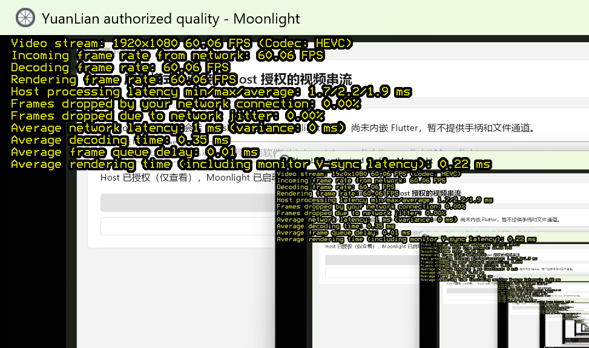

# Host 授权质量串流与流畅模式（0.3.0 / 协议 v3）

日期：2026-10-19。范围为本地 Windows Host、Windows 原生/Flutter 主控与隔离 WSL 控制服务。未部署生产机，未覆盖 0.2.0 发行资产。下述新路径覆盖早期“质量没有 Host 适配”的状态；旧独立预览仍保持自己的安全边界。

## 已实现

- `yl-proto` / Rust / Dart 的 Hello 升为 v3，新增 mode 与本次 Moonlight 公开证书。签名票据 v=2，mode 纳入签名；错误模式在消耗票据前拒绝，成功会话不可重放。
- `crates/yl-host/src/quality.rs`：沿用离线验签、Host 权限交集、本机授权、控制面开始确认后，才创建专用 Sunshine。独立目录、全新服务器身份、仅本次客户端证书、仅 Desktop 应用；不读写既有 Sunshine 配置。公开证书通过固定指纹 TLS 交换，客户端私钥留在本次 Moonlight 目录。
- Host 按实际输入权限配置 keyboard/mouse，关闭 controller/native_pen_touch，强制 LAN/WAN 加密模式 2。控制面撤权、过期、连接断开、心跳丢失结束受管实例；初始化期间也监测撤权/断开。原生 Job 在父进程异常退出时执行清理，而非按进程名杀其他实例。
- `crates/yl-runtime` 复用 Windows 原子 Job 监督器，校验内置固定 Moonlight 284 文件及 Sunshine 135 文件清单。新 `yl-viewer --mode quality --moonlight ...` 和 Flutter `quality_broker_page.dart` 使用独立临时客户端身份，无需手动 PIN 配对，也不读取已有配对私钥。
- Flutter 账号与设备页可选择质量 / 兼顾 / 流畅；首页有清晰的账号授权串流入口。启动、失败、结束、取消和重试均接真实业务；重试重新申请单次票据。质量画面仍在外部 Moonlight 窗口，Host 回执仅标“授权”，不伪造首帧或 FPS。
- `crates/yl-host/src/flow.rs`：64px 低质量变化图块 + 延迟精修、最新图块合并/公平轮转、有界队列。新增独立 FlowFrame 消息；reset 允许渐进填充，普通完整帧校验不放宽。分辨率变化时新代际清缓存重绘。
- flow 双向应用数据共用最高 100,000 B/s 预算，预留约 200 kbit/s 给传输开销，目标约 1 Mbps；文件最多 16,000 B/s 且不超过当前预算的 20%，2 KiB 文件块。控制优先，文件结束消息不得越过文件数据，文件等待份额时继续发画面。TCP 发送缓存 16 KiB，写阻塞减半预算、快速写入逐步恢复；最低 8,000 B/s，5 秒写超时退出。不是网络重传或网卡计费硬上限。

## 实际证据

| 验证 | 环境与结果 |
|---|---|
| Rust | Windows fmt/clippy（`-D warnings`）、workspace 31 测试通过；Host / viewer release 构建通过 |
| Flutter | analyze 无问题；全套 73 passed；新增质量授权页 1280×800 与 360dp/1.3，最终响应式 18 passed |
| 独立服务端 | WSL Ubuntu 24.04，0.3.0 fmt、release locked offline clippy、12 测试和 build 通过 |
| 原生生命周期 | `scripts/test-quality-native.ps1` 的真实子进程、输出背压/上限、参数、环境过滤、退出码 259、父进程强杀清理通过 |
| 真正的 Flutter flow 数据通路 | `client/live_test/flow_pipeline.dart` 在隔离真实 API 签票，通过固定指纹 TLS 收到 FlowFrame，进入 ready，通过实际 FrameQueue，再用 Flutter JPEG codec 解出真实图块；1 passed。没有 mock Socket、假设备或静态屏幕 |
| flow + 文件 + 心跳 | `scripts/test-quality-broker.py` / `mode_wire_client.py`：25.01 秒收到 1,001 个真实屏幕图块；平均 framed 应用数据 48,368 B/s；256 KiB 文件长度/偏移/SHA-256 一致；Ping p95 0.043 秒。另轮 25 秒 1,144 图块、53,332 B/s、p95 1.05 秒；不把图块更新数写成整屏 FPS |
| 模式绑定 / 重放 | 用 flow 票据申请 quality 被拒；随后同票据仍能合法建立 flow；实际使用后再次连接被拒 |
| Native 质量接入 | 真实账号签 quality 票据 → Host → 专用 Sunshine → 固定版 Moonlight，独立窗口真实出画；正常撤权结束会话 |
| 最终 native smoke 复测 | 最新 Host 二进制再次通过真实 Flutter flow 解码和 native 质量接入；撤权后专用 Sunshine 监听消失 0.955 秒、受管 Moonlight 退出 1.84 秒。Windows workspace 31 测试、WSL 独立服务端 12 测试及 release build 再次通过 |
| Flutter 质量接入 | `test-quality-broker.py --flutter` 使用真实 0.3.0 Windows release、真实 MethodChannel 和子进程。实际截图见下；上游浮层瞬时显示 1920×1080 HEVC，接收/解码/渲染均 60.06 FPS，网络/抖动丢帧 0.00%；Host 为仅查看 |
| Flutter 质量撤权 | 从真实撤权 API 请求开始，以 Windows 内核监听表测得专用 Sunshine HTTP 监听消失 **0.526 秒**；检测受管 Moonlight 退出 **0.878 秒**（含 PowerShell 查询开销）。没有用 PID 存活替代停止，也不把 connect() 的拒绝重试时间混入端口关闭时间 |



图为同机回环的真实桌面递归，不是静态示意。截图仅保留产品页和官方性能浮层；不归档测试凭据、配对私钥或含用户其他项目内容的桌面截图。这里的 60.06 是截图瞬时值，不能替代 10 分钟或两物理机性能验收。

## 使用

需要一起使用 0.3.0 Host、客户端和控制服务端。公开一键安装已更新为 0.3.0 Linux 服务端（v0.3.0 Release）；Windows/Android/Linux 桌面客户端安装包仍为 0.2.0，不能与 0.3.0 服务端混装。

```powershell
# 设备令牌通过 YUANLIAN_DEVICE_TOKEN 注入，不写在命令行或仓库中。
yl-host --server-url <控制服务URL> --sunshine <固定版Sunshine.exe完整路径>
# 需要键鼠时由本机明确添加 --allow-input；有效权限仍取票据和本机策略交集。
```

主控：账号与设备 → 新连接模式选“质量 · 视频串流 · Host 票据授权” → 连接设备 → 核对 Moonlight 路径 → 使用票据连接质量串流。流畅可在直连表单或账号页选择。Host 本机确认仍是实际业务前置；本轮隔离自动化显式使用 `--auto-approve`，未冒称实际点击了本机确认。

## 当前边界

- 单机 Windows 回环已验证；质量仅 IPv4、单会话、Desktop，仍外部窗口。未做两台物理机、跨 NAT、中继、两小时、4K/HDR/手柄/音频专项；未以本轮结果扩大历史性能宣称。
- 键鼠权限开关已实装；本轮实测为仅查看，未做同机按键回环，键鼠控制/撤权后按键状态仍需两机验收。
- Android/Linux 质量主控未实现；MuMu 多 Android 版本与真机适配本轮未执行。flow Dart 接收/解码和窄屏布局通过，不等于 Android 实体触控/弱网验收。
- flow 是低带宽渐进图块，空白区域待刷新；没有会话内热切换、音频/剪贴板/QUIC。大目录结果超过有界消息时明确提示以兼顾模式重连，不静默截断。网络重传/管理 API 不属于应用数据 pacing 的硬计费上限。
- 正常清理只操作本次独立目录；崩溃或 GPU 资源释放延迟可能留下本机私有临时目录，不会再次复用其中身份。未假称运行时哈希能防住同用户主动替换竞态。
- 生产升级、在线安装资产、签名、上游完整重编译与可复现分发仍需单独完成；本轮没有操作 192.168.9.66、nginx、VPN、Docker 或防火墙。

参考：[固定 Sunshine TLS 客户端验证](https://github.com/LizardByte/Sunshine/blob/63d35f702ee9e362e43263742981836ec0710384/src/nvhttp.cpp)、[强制媒体加密](https://github.com/LizardByte/Sunshine/blob/63d35f702ee9e362e43263742981836ec0710384/src/rtsp.cpp)、[Moonlight 官方性能统计](https://github.com/moonlight-stream/moonlight-qt/blob/v6.2.0/app/streaming/video/ffmpeg.cpp)。

## 对应源码

固定 Moonlight 主项目和 5 个递归子模块、Sunshine 主项目和 47 个递归子模块已获取并验证（实际数量以锁定清单为准）。完整源码在 `third_party/moonlight/source-checkouts/`，不可只用不带子模块的主项目 tarball。归档的递归 commit 清单在 `adapter-source/upstream-recursive-pins.json`；上游二进制未修改，远联改动均保留在本仓库源码。Windows 深路径触发 Git remote helper 长度限制后，已通过 WSL 在原 checkout 完成，不修改全局 Git/系统设置。没有因此宣称上游完整重编译或可复现分发已通过。
